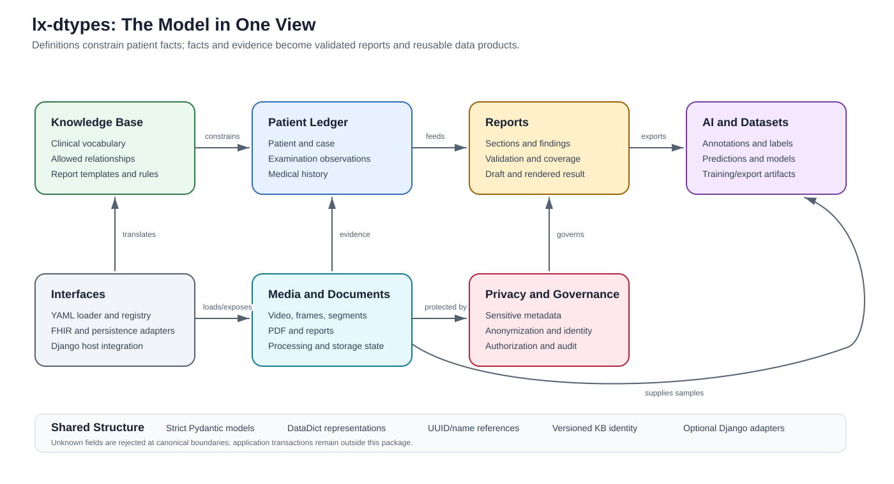
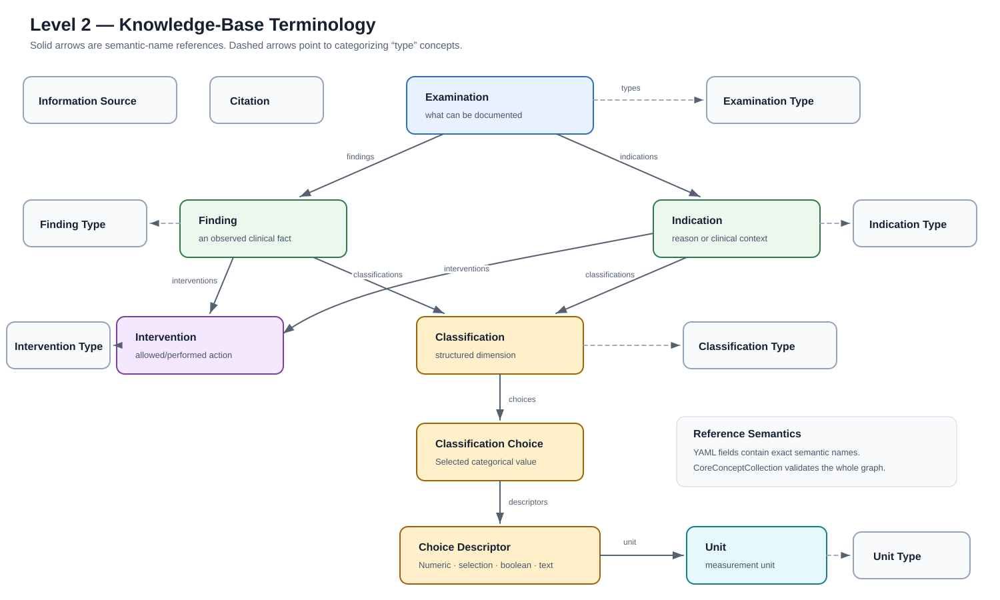
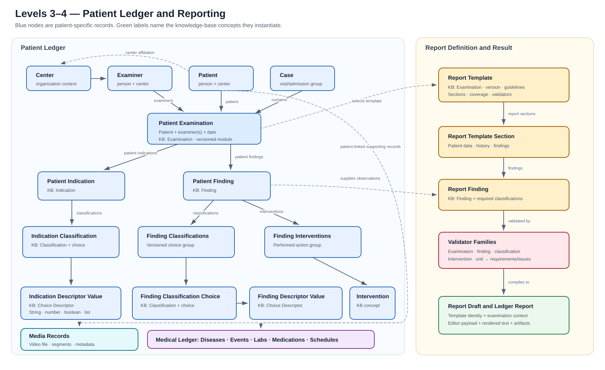

# Data-model concept map

This page is the public, layered map of the current `lx-dtypes` model. Start at
Level 0 and stop when you have enough detail. The full inventory is split into
levels because a single graph would contain hundreds of leaf payload types and
would not be readable.

Owner: lx_dtypes maintainers. This page is the canonical map of the package's
model areas, registries, important fields, and contract-module families.

## How to read the map

- An unprefixed clinical name such as `Finding` is a reusable knowledge-base
  definition: it describes what is allowed.
- A `P`-prefixed name such as `PFinding` is a patient-specific ledger record: it
  describes what was observed.
- Knowledge-base relations use exact semantic names in YAML. Ledger relations
  use UUID strings or nested validated models, depending on the representation.
- A solid arrow means “contains or references.” A dashed arrow is a cross-layer
  link or categorization.
- `*Type` concepts categorize a concept. `ClassificationChoice` supplies an
  allowed value. `ClassificationChoiceDescriptor` supplies an additional typed
  value such as a number, text, boolean, selection, or measurement.

## Level 0 — the whole package



The central path is:

> **Knowledge base → patient ledger → report → data product**

Media and documents provide evidence, AI contracts turn evidence into labels or
predictions, and privacy/governance contracts protect those flows. Interface
models translate external YAML, FHIR, storage, and Django representations into
the package-owned contracts.

| Area | Question it answers | Principal structures |
|---|---|---|
| Knowledge base | What may be documented? | terminology, types, report templates, validators |
| Patient ledger | What happened for this patient? | patient, case, examination, finding, indication, intervention, medical history |
| Reports | What must be shown and is it complete? | sections, requirements, graph, coverage, draft, rendered report |
| Media and documents | What evidence exists and what state is it in? | video, frame, segment, PDF, metadata, storage and processing state |
| AI and datasets | How is evidence labeled or learned from? | annotations, datasets, exports, predictions, model metadata |
| Privacy and governance | May this data be used or transferred? | sensitive metadata, anonymization, identity, authorization, audit |
| Interfaces | How does data enter, leave, or persist? | loaders, registries, FHIR, persistence payloads, Django host contracts |

## Level 1 — shared structure and representations

Most domain models share a small inheritance backbone:

The backbone inherits `DtypesModel`. Standalone contracts and helper models use
the same closed, strict, frozen, or typed-root profiles. Evaluation and reviewed
exceptions are defined in the [cross-layer contract](cross-layer-validation.md).

```text
AppBaseModel                              source_file, created_at
└── AppBaseModelUUIDTags                  uuid, tags
    ├── AppBaseModelNamesUUIDTags         name, name_de, name_en, description
    │   └── KnowledgebaseBaseModel        kb_module_name
    ├── LedgerBaseModel                   external_ids, nested→serialized flattening
    ├── MetaBaseModel
    └── StateBaseModel
```

The same concept may have several deliberately separate representations:

| Representation | Role |
|---|---|
| Pydantic model | Canonical runtime validation and model behavior |
| `DataDict` | Typed dictionary and compatibility representation |
| Serialized ledger model | Nested ledger objects flattened to identifiers |
| Core contract | Strict cross-service/API shape with no application behavior |
| Django model or host contract | Optional persistence adapter; coverage is intentionally not one-to-one |

`AppBaseModel` strips surrounding whitespace, validates defaults, rejects unknown
fields, and revalidates nested model instances. External data should cross one of
these validated boundaries once, rather than coexist with a loose dictionary.

## Level 2 — knowledge-base terminology



The `KnowledgeBase` aggregates registered model types. The terminology graph
itself has 17 concepts; 7 are categorizing type concepts.

| Definition | Direct references or special fields |
|---|---|
| `Examination` | `examination_types`, `findings`, `indications` |
| `Finding` | `finding_types`, `classifications`, `interventions`, `caused_by_interventions` |
| `Indication` | `indication_types`, `classifications`, `interventions` |
| `Intervention` | `intervention_types` |
| `Classification` | `classification_types`, `classification_choices` |
| `ClassificationChoice` | `classification_choice_descriptors` |
| `ClassificationChoiceDescriptor` | descriptor type, numeric/selection/boolean/text constraints, optional `unit` |
| `Unit` | `abbreviation`, `unit_types` |
| `InformationSource` | `information_source_types` |
| `Citation` | bibliographic identity, authors, publication data, DOI/URL, identifiers |
| `TimeReference` | reference/target clock kinds and labeled reference, training, validation, and test examples |
| `ElectricalCurveProfile` | HF curve quantities, regression responses and predictors, phase bins, duration and gap limits, reference count, deviation threshold |

The categorizing concepts are `ExaminationType`, `FindingType`,
`IndicationType`, `InterventionType`, `ClassificationType`, `UnitType`, and
`InformationSourceType`. `ClassificationChoiceDescriptor` has descriptor-type
behavior rather than a separate registered `*Type` model.

`KnowledgeBaseIdentity` is the version boundary. It requires both
`knowledge_base_module` and `knowledge_base_version` and has the canonical form
`module@version`. `CoreConceptCollection` is the strict cross-layer snapshot: it
rejects duplicate concept names, reused UUIDs, dangling semantic-name
references, unknown fields, and incomplete knowledge-base identity pairs.
Descriptor numbers in the snapshot are finite, and their ranges, selection
cardinalities, default options, and probabilities are consistent. Legacy
knowledge bases that use infinity for an unbounded numeric range export that
bound as `null` at the JSON boundary.

## Level 3 — patient ledger



The ledger registry contains named observation models across the branches below.

### Examination branch

```text
Center ─┬─ Examiner
        └─ Patient ─ Case
                     └─ PExamination [Examination + module@version]
                        ├─ PIndication [Indication]
                        │  └─ PIndicationClassification [Classification + Choice]
                        │     └─ PIndicationClassificationDescriptor [Descriptor value]
                        └─ PFinding [Finding]
                           ├─ PFindingClassifications
                           │  └─ PFindingClassificationChoice [Classification + Choice]
                           │     └─ PFindingClassificationChoiceDescriptor [Descriptor value]
                           └─ PFindingInterventions
                              └─ PFindingIntervention [Intervention]
```

Square brackets show the knowledge-base definition referenced by a patient
record. `Examiner` and `Patient` belong to a `Center` and carry the shared
person fields `first_name`, `last_name`, `dob`, `email`, `gender`, `phone`,
`street`, `city`, `state`, `zip_code`, and `country`. Descriptor values are the actual patient values and accept string,
integer, float, boolean, or a list of strings.

### Report, medical, and media branches

- `Case` groups patient examinations and report identifiers between admission
  and discharge dates.
- Ledger `Report` stores the examination link, immutable template identity,
  lifecycle status, editor payload, context snapshots, rendered text, and
  version state.
- `PatientMedicalLedger` groups `PatientDisease`, `PatientEvent`,
  `PatientLabSample`, `PatientLabValue`, `PatientMedication`, and
  `PatientMedicationSchedule`.
- `VideoFile` and `PatientVideoFile` connect patient and examination context to
  technical metadata, segments, storage paths, anonymization state, and
  sensitive metadata.
- `PTimeOffset` links an examination to a version-pinned `TimeReference` and
  exact clock evidence using existing video PTS coordinates. See
  [dates, times, and offsets](dates-and-times.md#knowledge-base-references-and-ledger-observations).
- `PElectricalApplication` stores one HF activation as a phase-binned curve
  pinned to an `ElectricalCurveProfile` version; `PElectricalCurveComparison`
  stores its regression comparison with strictly earlier applications. See
  [electrosurgical measurements](electrosurgical-video-alignment.md#application-curves-and-regression-comparison).

The ledger has both nested and serialized forms. Nested forms are convenient for
validation and traversal; serialized forms replace nested records with UUID
references for transport or persistence.

## Level 4 — reports and validators

`ReportTemplate` is a knowledge-base definition, not the produced patient
report. It selects one `Examination`, versioned guideline references, coverage
concepts, ordered sections, and five validator families.

```text
ReportTemplate
├── ReportTemplateSection
│   ├── patient/history fields
│   └── ReportFinding
│       └── required Classification references
├── ExaminationValidator
├── FindingsValidator
├── ClassificationValidator
├── InterventionValidator
└── UnitValidator
    └── ValidatorRequirementReference
        └── finding | classification | choice | intervention | unit
```

The template can be compiled into `ReportTemplateGraph`, assessed as
`ReportConceptCoverage`, checked structurally, and evaluated against a concrete
ledger examination at runtime. `PatientExaminationReportDraft` binds the
template identity to editable examination content. Submission/make-report
contracts produce persisted artifacts and the ledger `Report`.

This separation answers three different questions:

1. **Structure:** Is the template graph internally valid?
2. **Coverage:** Does the template represent the intended clinical concepts?
3. **Runtime:** Does this patient examination satisfy the applicable rules?

## Level 5 — supporting contract families

Leaf request, response, enum, `TypedDict`, and helper models are grouped by
their owning concept family. Every public module of
`lx_dtypes.models.contracts` belongs to exactly one family:

| Family | Modules in `lx_dtypes.models.contracts` |
|---|---|
| Contract infrastructure | `adapters`, `json_types`, `validation` |
| Clinical and terminology | `assessment`, `contraindication`, `core_concepts`, `electrical_curve`, `electrosurgical_activations`, `electrosurgical_measurements`, `event`, `examination_indication`, `examination_time`, `examination_type`, `fhir_clinical`, `finding_classification`, `finding_intervention`, `german_fhir`, `information_source`, `kbv_key_tables`, `knowledge_base`, `knowledge_base_graph`, `lab_value`, `medication`, `numeric_classification`, `numeric_value_distribution`, `patient_examination`, `patient_finding`, `patient_finding_classification`, `patient_finding_classification_runtime`, `patient_finding_intervention`, `patient_view`, `reference_catalog`, `reference_catalog_snapshot`, `reference_metadata`, `subcategory_validation`, `terminology_catalog`, `time`, `time_reference` |
| Reporting and documents | `document_type`, `examination_revision`, `finding_extraction`, `patient_examination_report`, `pdf_file`, `pdf_meta`, `pdf_redaction`, `report`, `report_anonymization`, `report_context`, `report_draft`, `reporting_types` |
| Video and media | `electrical_video_alignment`, `endoscopy_processor`, `export_annotated`, `export_ready`, `ffmpeg_metadata`, `image_processing`, `label_video_segment_serializer`, `media_management`, `media_streaming`, `media_workflow`, `media_workflow_api`, `media_workflow_policy`, `nginx_accel`, `video_correction`, `video_examination`, `video_export`, `video_file`, `video_format`, `video_frame`, `video_frame_annotations`, `video_frame_box_annotations`, `video_frame_cache`, `video_frame_export`, `video_masks`, `video_processing`, `video_processing_history`, `video_provenance`, `video_reimport`, `video_segment_timeline`, `video_segment_validation`, `video_segments`, `video_state`, `video_temporal_inference`, `video_text_metadata` |
| AI and annotation | `ai_dataset`, `ai_model`, `ai_prediction`, `aidataset_export`, `aidataset_frame_buckets`, `finding_review`, `frame_annotation`, `hub_active_learning`, `huggingface_model_meta`, `llm_extractor`, `llm_service`, `model_meta`, `model_meta_logic`, `multilabel_classification`, `text_embedding`, `video_ai_labels`, `video_prediction_logic` |
| Privacy, identity, and audit | `anonymization`, `anonymization_metrics`, `anonymization_overview`, `anonymization_quality`, `audit_ledger`, `authz`, `case_resolution`, `frame_anonymization`, `pseudonymization`, `sensitive_meta_update`, `sensitive_patient_data`, `text_anonymization`, `text_detection`, `validated_identity` |
| Studies and cohorts | `cohort_definition`, `study`, `study_analysis`, `study_cohort`, `study_collection`, `study_exchange`, `study_label_presentation`, `study_metadata`, `study_setup`, `study_text_extraction` |
| Transfer, configuration, and operations | `application_settings`, `codemod_rename`, `dataset_lifecycle`, `deployment_setup`, `dicom_export`, `django_settings`, `dtypes_record_persistence`, `hub_ingest`, `hub_media_envelope`, `hub_transfer`, `legacy_data_import`, `lx_anonymizer_performance`, `maintenance_repair`, `management_command`, `migrate_data_dir`, `migrate_media_storage`, `name_fixtures`, `package_channel`, `package_kind`, `package_snapshot`, `permission_runtime`, `sap_ish_import`, `setup_config`, `table_import`, `transfer_validation`, `translation`, `upload` |

The metadata branch adds three cross-cutting structures:

- `SensitiveMeta` and `SensitiveMetaState` hold sensitive-data identity and
  lifecycle state.
- `VideoMeta` adds ROI, PHI-region, observation, removal-plan, format-probe, and
  anonymizer-provenance structures.
- `ReportMeta` adds parsed patient/examiner/examination/endoscope information,
  redaction/crop state, and report-processing provenance.

## External boundaries

Numeric interpretation adds `NumericMeasurement`, `NumericClassificationRule`,
`NumericClassificationRules`, and `NumericClassificationResult` in
`models/contracts/numeric_classification.py`. The public
`lx_dtypes.numeric_classification` module resolves an exact KB release and its
strict YAML rule sidecar. A result retains the original measurement and source
KB identity alongside the interpretation identity and rule digest. These are
derived contracts; they do not add another ledger entity or KB registry model.
See the [versioning workflow](knowledge-base-authoring.md#reproduce-and-maintain-versioned-numeric-classifications).

| Boundary | Entry/result |
|---|---|
| YAML | `DataLoader`, `KnowledgeBaseConfig`, and `KnowledgeBase` produce a validated module graph |
| Registry | `KnowledgeBaseResolver` selects an exact registered `module@version` |
| FHIR terminology | CodeSystem/Bundle conversion maps supported domains to knowledge-base collections |
| FHIR clinical | Strict Patient, Observation, Condition, DiagnosticReport, coding, quantity, and bundle contracts |
| Persistence | `DtypesRecordPersistencePayload` carries a validated examination tree and optional complete KB identity |
| Django | Package adapters and explicit host contracts map selected models to persistence; transactions stay with the host application |
| Public API | Snake-case Pydantic contracts are canonical; frontend casing belongs in one named transport adapter |

## Cross-repository reuse

Other applications consume these contracts:

| Consumer | Uses |
|---|---|
| endoreg-db | Persistence adapters, API validation, datasets, and hub ingest |
| lx-annotate | Annotation workflows and outbound hub payloads |
| lx-anonymizer | OCR, media processing, report extraction, and anonymization |

**Imports.** Public contract names resolve on demand. Import a contract through
its public domain module or through `lx_dtypes.models.contracts`. Importing OCR,
hub-transfer, video-processing, or dataset-export contracts does not require
Django settings or an installed consumer application. Individual patient-video
contracts do not load the aggregate Django registry, but the ledger registry
exports still need the host's Django setup. Import isolation does not change
installation dependencies: the distribution still declares Django and its
scientific and media dependencies.

**Aliases.** `AIDataSetScoredActiveLearningCandidateContractContract` is a
compatibility alias of `AIDataSetScoredActiveLearningCandidateContract`; both
names identify the same model. Use the canonical name in new code.

**Separate representations are intentional:**

- Pydantic models, `TypedDict` representations, and Django adapters serve
  runtime validation, static transport typing, and persistence. Similar fields
  do not make these classes interchangeable.
- Named clinical concepts stay distinct even when their fields currently match.
  Their semantic identities and schema names are part of the public contract.
- JSON value aliases keep their domain's nullability and serialization
  behavior. Similar recursive unions are not a reason to merge them.
- The frame-cache manifest and validation payloads in
  `contracts.video_frame_cache` share field definitions, but the
  `Video`-prefixed variants are frozen and require `db_extracted_frame_count`,
  while the mutable validation variant defaults it to zero.

## Source locations

| Area | Package path |
|---|---|
| Base models | `lx_dtypes/models/base` |
| Knowledge base | `lx_dtypes/models/knowledge_base` |
| Ledger | `lx_dtypes/models/ledger` |
| Contracts | `lx_dtypes/models/contracts` |
| Metadata | `lx_dtypes/models/meta` |
| Interfaces | `lx_dtypes/models/interface` |
| Django | `lx_dtypes/django` |
| Serialization | `lx_dtypes/serialization` |

## Scope and maintenance

This is a concept map, not a promise that every class is a database table and
not a field-by-field API reference. Test fixtures, migrations, generated docs,
and implementation-only helpers are outside the map. A new public model area
must be added to the appropriate level on this page in the same change. The
test suite checks that every contract module appears in the Level 5 table.

For detailed authoring and boundary rules, continue with
[Knowledge-base authoring](knowledge-base-authoring.md),
[Cross-layer validation](cross-layer-validation.md), and
[Django host integration](django-host-integration.md).
